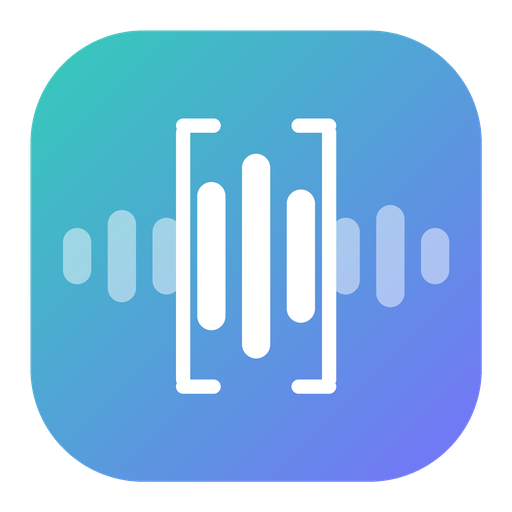
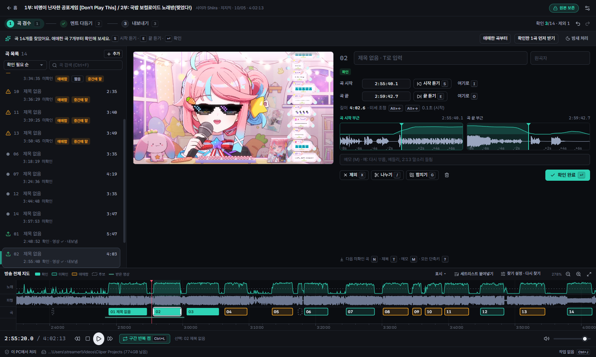
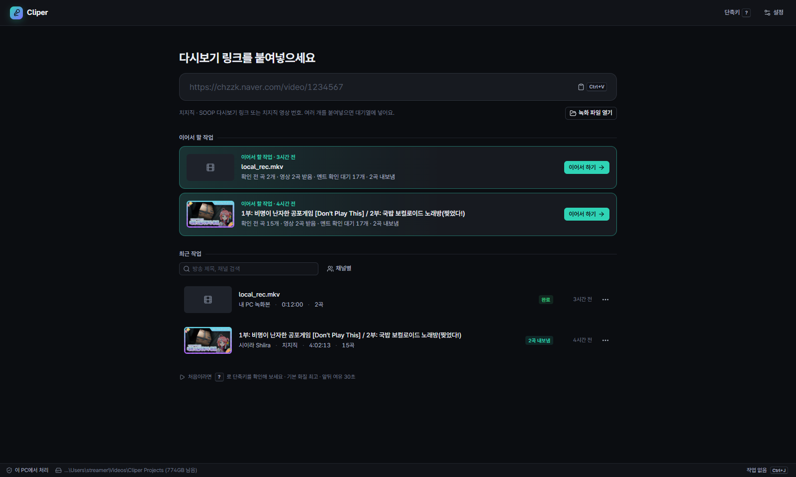
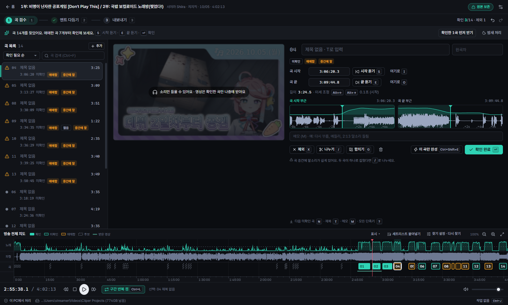
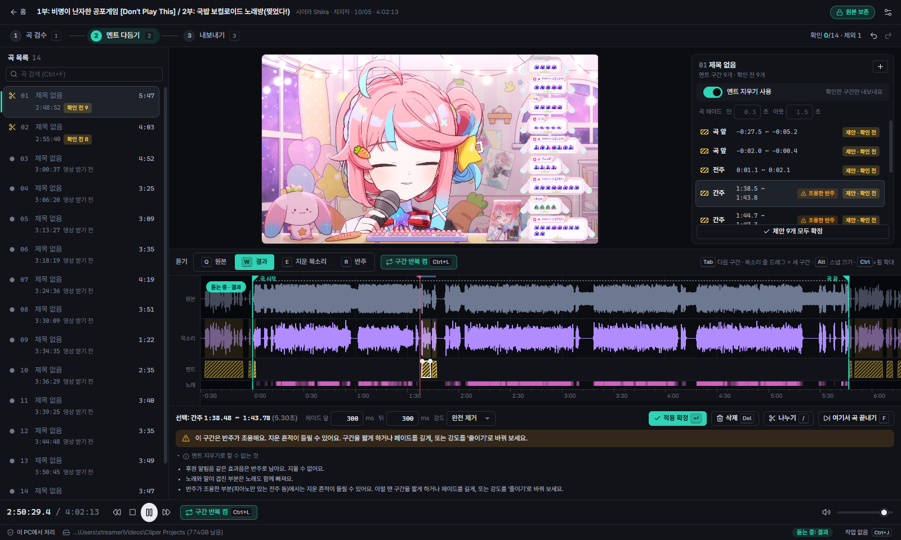
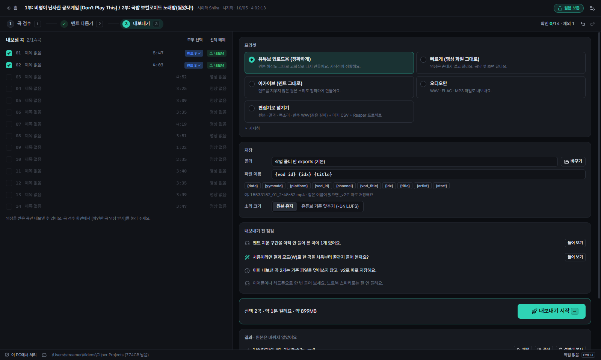

# Cliper (클리퍼)

**노래방송 다시보기에서 노래만 골라 곡별 영상으로 뽑아 주는 Windows 앱**

치지직·SOOP 다시보기 링크를 넣으면 노래 구간을 찾아 줘요. 
곡 앞뒤에 반주 위로 겹친 멘트는 목소리만 지우고 반주는 살려요.

 
방송 전체 지도에서 찾은 곡을 한눈에 보고, 시작·끝을 들어 확인해요.

### [최신 릴리즈 (Windows)](https://github.com/ouor/cliper/releases/latest)

> [!NOTE]
> **비공식 앱이에요.** Cliper는 NAVER, 치지직(CHZZK), SOOP과 관련이 없고, 공식으로 제공하거나 승인한 앱이 아니에요. 
> 각 서비스 웹에서 쓰는 공개되지 않은 API를 사용해서, 서비스가 바뀌면 갑자기 동작하지 않을 수 있어요.

> [!IMPORTANT]
> 방송 영상과 노래의 권리는 스트리머와 원곡 권리자에게 있어요. 만든 클립을 올리기 전에 스트리머의 클립 정책과 저작권을 꼭 확인해 주세요.

## 📸 이렇게 써요

1. **링크 넣기**: 다시보기 링크를 붙여 넣거나 녹화 파일을 끌어다 놓아요. 소리만 먼저 받아서 4시간 방송도 1분 안팎이면 노래 구간을 찾아요.
2. **곡 검수**: 방송 전체 지도에서 찾은 곡을 확인하고, 시작과 끝을 끌어서 다듬어요. 놓친 곡 후보도 점선으로 보여 줘요.
3. **멘트 다듬기**: 고른 곡의 영상만 받아(기본 1080p, 설정에서 바꿀 수 있어요) 목소리와 반주를 나눠요. "안녕하세요~", "Melt라는 노래였습니다~" 같은 멘트를 찾아 지울 구간으로 제안해 주면, 들어 보고 확인만 하면 돼요.
4. **내보내기**: 곡마다 mp4로 뽑거나 wav·flac·mp3로 소리만 뽑아요. 유튜브 챕터와 곡 목록도 같이 만들어요.

 홈: 다시보기 링크를 붙여넣거나 녹화 파일을 열면 시작해요. · 곡 검수: 애매한 곡부터 확인하고, 점선 후보로 놓친 노래도 찾아요.

 멘트 다듬기: 노래 사이 멘트를 구간으로 지우고, 결과를 바로 들어 봐요. · 내보내기: 용도에 맞는 프리셋을 고르면 곡별 영상으로 내보내요. 원본은 그대로예요.

## ✨ 할 수 있는 것

- **소리 먼저, 영상은 필요한 만큼만**: 방송 전체는 소리만 받아 노래를 찾고, 영상은 고른 곡 앞뒤만 받아요. 4시간짜리 방송을 통째로 받을 필요가 없어요.
- **노래 구간 자동 찾기**: 노래, 말소리, 반주를 구분하는 인공지능으로 곡을 찾아요. 애매한 곡에는 표시를 해 두고, 놓친 곡 후보도 보여 줘요.
- **멘트만 지우기**: 목소리와 반주를 나눠서, 반주 위에 겹친 멘트만 지우고 반주는 그대로 이어지게 해요. 지울 구간과 페이드 길이, 강도(완전 제거·줄이기)를 곡마다 고를 수 있어요.
- **들어 보며 고치기**: 원본·결과·지운 목소리·반주를 재생 위치 그대로 바꿔 들으며 확인해요. 고친 내용은 되돌리기·다시 하기가 돼요.
- **세트리스트 붙여 넣기**: 팬이 정리한 타임스탬프나 세트리스트를 붙여 넣으면 곡 제목과 원곡 가수를 채워 줘요.
- **여러 방송 한 번에**: 링크 여러 개를 넣어 두고 밤사이 처리할 수 있어요. 작업 중에는 PC가 절전 모드로 들어가지 않아요(설정에서 끌 수 있어요).
- **녹화 파일도**: OBS 같은 녹화 파일도 그대로 넣을 수 있어요. 오디오 트랙이 여러 개면 고를 수 있어요.
- **편집 프로그램으로 넘기기**: 곡별 원본·결과·보컬·반주 WAV와 마커, Reaper 프로젝트를 뽑아 편집 프로그램에서 이어서 다듬을 수 있어요.
- **화질 고르기**: 원본 그대로 또는 1080p·720p·480p·360p로 골라 내보낼 수 있어요. 해상도와 비트레이트를 직접 정할 수도 있어요.
- **음량 맞추기**: 곡마다 유튜브 기준(−14 LUFS) 같은 음량으로 맞춰 내보낼 수 있어요.

### 이럴 때 써 보세요

- 노래방송 다시보기에서 곡별 클립을 만들고 싶은데, 몇 시간짜리 영상을 처음부터 돌려 보기 힘들 때
- 곡 앞뒤 멘트 때문에 깔끔하게 자르기 어려웠을 때
- 매주 노래방송을 아카이브하는데, 곡 목록과 타임스탬프 정리에 시간이 많이 들 때
- 클립을 편집자에게 넘기기 전에 곡 구간만 빠르게 정리해 두고 싶을 때

## ⬇️ 설치하기

[최신 릴리즈](https://github.com/ouor/cliper/releases/latest)에서 `cliper-v0.3.1-amd64.exe`를 받아요. 설치 없이 바로 실행하는 포터블이에요. 켤 때마다 압축을 풀어서 시작이 몇 초 걸려요.

1. 받은 파일을 원하는 폴더에 두고 실행해요.
2. "Windows의 PC 보호" 창이 뜨면 **추가 정보 → 실행**을 눌러요. 코드 서명을 하지 않은 앱이라 뜨는 안내예요.
3. 처음 켜면 작업 폴더를 고르고 PC를 확인해요.

**NVIDIA 그래픽카드가 있으면** 처음 켤 때 GPU 가속 구성요소(약 1 GB)를 앱이 자동으로 받아요. 받는 동안에도 CPU로 계속 쓸 수 있고, 다 받으면 앱이 엔진을 다시 시작해 GPU를 써요. 그래픽카드가 없으면 받지 않고 CPU로 동작해요.

**업데이트**는 새 버전 파일을 받아 실행하면 돼요. 작업 폴더의 프로젝트와 설정, 받아 둔 GPU 가속 구성요소는 그대로 남아요. 0.2.x 이전에 설치 파일로 설치했다면 Windows 설정 → 앱에서 지워도 돼요(프로젝트는 지워지지 않아요).

> [!WARNING]
> 이 저장소의 [릴리즈](https://github.com/ouor/cliper/releases)에서 받은 파일만 실행해 주세요.

### 필요한 것

- Windows 10/11 64비트
- 메모리 8 GB 이상(16 GB 권장)
- 저장 공간: 앱 약 1.3 GB, GPU 가속 구성요소 약 1.4 GB, 방송 하나에 소리 100~200 MB + 받은 곡 영상
- (권장) NVIDIA 그래픽카드, 드라이버 R580 이상, VRAM 4 GB 이상. 없어도 동작하지만 목소리 나누기가 많이 느려요(RTX 3090에서 7분 곡이 10초쯤, CPU에서는 몇 분).
- 인터넷 연결
- 앱 화면은 한국어로 나와요.

## 🔒 개인정보

- 모든 처리(노래 찾기, 목소리 나누기, 내보내기)는 **내 PC 안에서** 해요. 소리나 영상을 다른 서버로 보내지 않아요.
- 앱이 통신하는 곳은 치지직·SOOP(방송 정보와 영상), GitHub(GPU 가속 구성요소를 받을 때 한 번)뿐이에요.
- 구독자 전용 다시보기를 보려고 넣은 로그인 쿠키는 **Windows 계정으로 암호화해서** 이 PC에만 저장해요. 비밀번호는 받지 않아요. 설정에서 언제든 지울 수 있어요.
- 광고와 분석 도구가 없어요.

## 🙋 자주 묻는 질문

| 이럴 때 | 이렇게 해 보세요 |
|---|---|
| 실행하면 "Windows의 PC 보호"가 떠요 | **추가 정보 → 실행**을 눌러 주세요. 코드 서명을 하지 않아서 뜨는 안내예요. |
| 구독자 전용 다시보기가 안 열려요 | 설정 → 고급의 **로그인 쿠키**에서 **설정…**을 눌러 치지직 `NID_AUT`, `NID_SES`를 넣고 **지금 확인**을 눌러 주세요. |
| 곡이 너무 좁게 잡혀요 | 곡의 시작과 끝을 끌어서 늘려요. 받아 둔 영상 범위를 넘으면 **영상 다시 받기**로 그 곡의 영상을 다시 받아요. 설정에서 앞뒤 여유를 늘릴 수도 있어요. |
| 놓친 곡이 있어요 | 지도의 점선 후보를 누르고 **곡으로 추가**를 누르거나, 지도에서 직접 끌어서 구간을 만들어요. |
| 멘트가 조금 남아요 | 멘트 다듬기에서 지울 구간을 넓히거나 페이드를 짧게 해 주세요. 마이크 에코가 강하면 잔향이 남을 수 있어요. |
| "타이밍 확인 필요"가 떠요 | 받은 영상과 방송 소리를 맞추지 못한 곡이에요. 곡의 시작과 끝을 들어 보고 확인해 주세요. |
| GPU를 안 써요 | 설정 → 고급의 **GPU 가속**에서 설치됐는지 보고, 없으면 **설치**나 **zip 파일로 설치**를, 설치돼 있는데도 안 쓰면 **다시 설치**를 눌러 주세요. NVIDIA 드라이버가 오래됐으면 업데이트해 주세요. |
| GPU 가속 구성요소를 받지 못해요 | [릴리즈](https://github.com/ouor/cliper/releases/tag/v0.1.0)에서 `cliper-cuda-addon-v1-amd64.zip`을 직접 받아, 설정 → 고급의 **zip 파일로 설치**로 넣어 주세요. |
| 저장 공간이 부족해요 | 설정 → 고급의 **저장 공간 정리**에서 **받은 영상만 지우기**를 눌러요. 곡 구간과 편집 내용은 남아요. |

문제가 계속되면 [이슈](https://github.com/ouor/cliper/issues)에 방송 링크와 함께 남겨 주세요. 설정 → 고급의 **진단 정보 복사**를 붙여 주시면 더 빨리 볼 수 있어요.

---

## 🛠️ 개발자 노트

여기부터는 앱을 직접 빌드하거나 고치려는 분을 위한 내용이에요.

- 빌드 방법과 구조: [docs/DEVELOPMENT.md](docs/DEVELOPMENT.md)
- 엔진 IPC 계약: [docs/ipc.md](docs/ipc.md)
- 쓰인 기술
  - 엔진: Rust, tokio, ONNX Runtime(CUDA), ffmpeg
  - 노래 찾기: PANNs `Cnn14_DecisionLevelMax`([song-split-research](https://github.com/ouor/song-split-research) v6 분할기)
  - 목소리 나누기: UVR MDX-Net `Voc_FT`
  - 앱: Electron, React, TypeScript, zustand, Web Audio(AudioWorklet)
- 라이선스: [MIT](LICENSE). 함께 배포하는 모델과 런타임(PANNs, UVR MDX-Net, ONNX Runtime, ffmpeg, CUDA/cuDNN)은 각자의 라이선스를 따라요.
